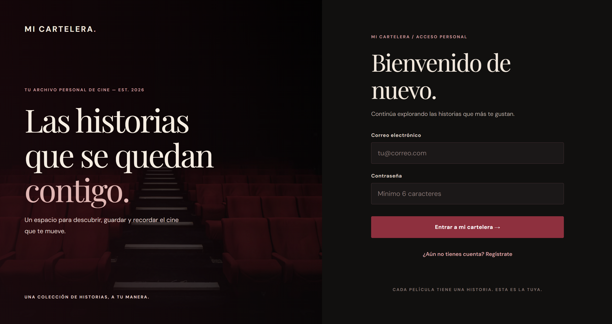
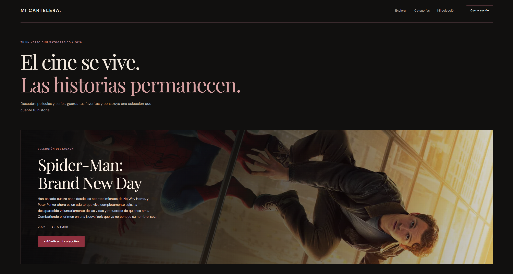
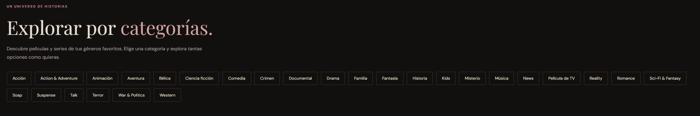
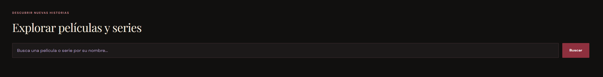
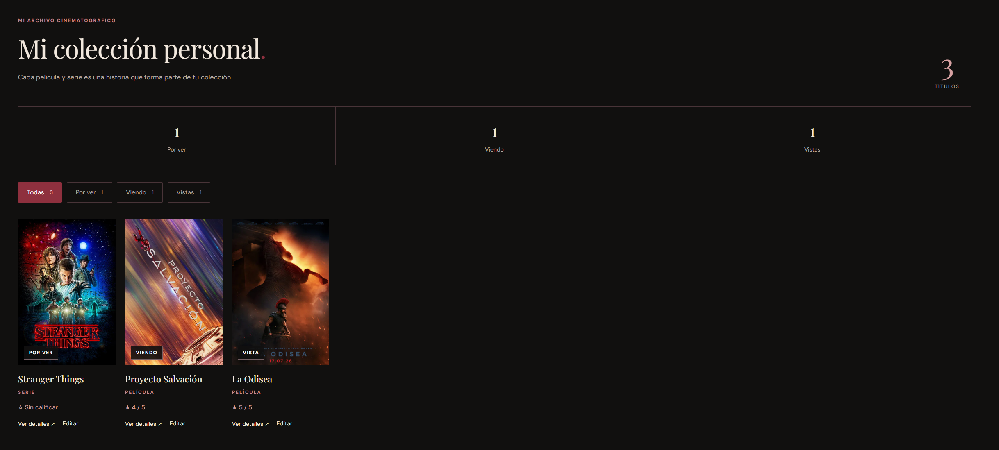
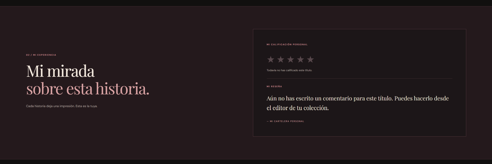

# 🎬 Mi Cartelera Personal

**Aplicación web para descubrir, organizar y calificar películas y series.**

Mi Cartelera Personal es una aplicación desarrollada como proyecto de la materia **Desarrollo Web 2**, que permite a cada usuario construir su propia colección cinematográfica.

La aplicación integra la API de **The Movie Database (TMDB)** para consultar información de películas y series, y utiliza **Supabase** para gestionar la autenticación y almacenar las colecciones personales.

Su identidad visual está inspirada en el cine editorial, utilizando una paleta de negro, vino y marfil, tipografía elegante e imágenes cinematográficas.

---

## 1. Objetivo del proyecto

Desarrollar una aplicación web full-stack que integre un frontend interactivo, una API externa y una base de datos relacional, permitiendo a los usuarios administrar una colección personal de películas y series de manera segura.

## 2. Funcionalidades

### Autenticación de usuarios
- Registro mediante correo electrónico y contraseña.
- Inicio y cierre de sesión.
- Colección personal asociada a cada usuario.

### Exploración de contenido
- Consulta de películas populares.
- Búsqueda de películas y series mediante TMDB.
- Exploración por géneros cinematográficos.
- Filtros por tipo de contenido: películas o series.
- Ordenamiento por criterios como popularidad, valoración y fecha.
- Carga de más resultados para descubrir nuevos títulos.

### Información cinematográfica
- Póster y título.
- Sinopsis.
- Año de estreno.
- Calificación oficial de TMDB.
- Géneros y otros datos disponibles.
- Número de temporadas para series.
- Fichas cinematográficas a pantalla completa.

### Colección personal
- Agregar películas y series.
- Consultar los títulos guardados.
- Modificar el estado de visualización.
- Asignar una calificación personal de 1 a 5 estrellas.
- Escribir comentarios y reseñas.
- Editar o eliminar títulos.
- Filtrar la colección según el estado de visualización.

Los estados disponibles son **Por ver**, **Viendo** y **Vista**.

## 3. Tecnologías utilizadas

| Tecnología | Función |
|---|---|
| React | Desarrollo de interfaces mediante componentes |
| TypeScript | Tipado estático y organización del código |
| Vite | Entorno de desarrollo y compilación |
| CSS | Diseño responsive e identidad visual |
| TMDB API | Información de películas y series |
| Supabase Auth | Registro y autenticación |
| Supabase PostgreSQL | Almacenamiento de datos |
| Supabase RLS | Restricción del acceso a registros según el usuario |
| Git y GitHub | Control de versiones y Pull Requests |

## 4. Arquitectura general

La aplicación utiliza una arquitectura frontend conectada a dos servicios externos.

**React + TypeScript** gestiona la interfaz y las interacciones del usuario.

**TMDB API** proporciona la información cinematográfica, como títulos, imágenes, sinopsis, calificaciones y temporadas.

**Supabase** administra las cuentas de usuario y almacena su colección personal en PostgreSQL.

El frontend se comunica con TMDB para consultar contenido y con Supabase para autenticar usuarios y gestionar registros.

## 5. Base de datos

La tabla principal se llama `movies` y almacena películas y series guardadas.

| Campo | Descripción |
|---|---|
| `id` | Identificador del registro |
| `user_id` | Identificador del usuario |
| `movie_id` | Identificador del título en TMDB |
| `title` | Nombre de la película o serie |
| `poster_path` | Ruta del póster |
| `media_type` | Tipo de contenido: `movie` o `tv` |
| `watch_status` | Estado de visualización |
| `personal_rating` | Calificación personal |
| `personal_comment` | Comentario del usuario |
| `created_at` | Fecha de creación del registro |

La combinación de usuario, identificador de TMDB y tipo de contenido permite distinguir películas y series y evitar registros duplicados del mismo título para un usuario.

### Seguridad

La tabla `movies` tiene habilitado **Row Level Security (RLS)**.

Las políticas de `SELECT`, `INSERT`, `UPDATE` y `DELETE` utilizan condiciones basadas en `auth.uid() = user_id` para restringir el acceso a los registros del usuario autenticado.

De esta forma, las colecciones personales cuentan con protección desde la base de datos, además de las comprobaciones realizadas en el frontend.

## 6. Instalación y ejecución

### Requisitos previos

- Node.js y npm.
- Un proyecto de Supabase configurado.
- Una credencial válida para la API de TMDB.

### Clonar el repositorio

```bash
git clone https://github.com/Mjmaria27/Mi-Cartelera-Personal.git
cd Mi-Cartelera-Personal
```

### Instalar dependencias

```bash
npm install
```

### Configurar variables de entorno

Crear un archivo `.env` en la raíz del proyecto con las siguientes variables:

```env
VITE_SUPABASE_URL=TU_URL_DE_SUPABASE
VITE_SUPABASE_ANON_KEY=TU_CLAVE_PUBLICA_DE_SUPABASE
VITE_TMDB_API_KEY=TU_API_KEY_DE_TMDB
```

Reemplazar los valores de ejemplo por las credenciales correspondientes.

**Importante:** las variables con prefijo `VITE_` se incorporan al código del navegador. No deben contener secretos administrativos, como una clave `service_role` de Supabase. La seguridad de los datos se aplica mediante las políticas RLS.

El archivo `.env` no debe subirse al repositorio.

### Iniciar el servidor de desarrollo

```bash
npm run dev
```

Abrir en el navegador la dirección local indicada por Vite, normalmente:

`http://localhost:5173/`

### Generar una compilación

```bash
npm run build
```

## 7. Diseño visual

El diseño de Mi Cartelera Personal toma como referencia las publicaciones editoriales y la estética cinematográfica.

Se emplean:

- Colores negro, vino y marfil.
- Tipografía serif para títulos.
- Fotografías y pósters de gran tamaño.
- Tarjetas interactivas.
- Composición visual con jerarquía tipográfica.
- Secciones dedicadas a exploración, colección y detalles.

El objetivo es crear una experiencia de navegación que combine la funcionalidad de una plataforma de entretenimiento con la identidad visual de una revista de cine.


## 8. Capturas de pantalla














## 9. Control de versiones

El desarrollo se organizó mediante ramas de Git y Pull Requests en GitHub, con el objetivo de registrar los avances y separar los cambios importantes.

Las etapas principales incluyeron:

- Rediseño de la autenticación.
- Diseño editorial de la página principal.
- Rediseño de la colección y tarjetas interactivas.
- Nueva pantalla de detalles cinematográficos.
- Integración de películas y series.
- Exploración por categorías.
- Documentación y revisión final.

## 10. Autoría

Proyecto académico desarrollado para la materia **Desarrollo Web 2** de la **Universidad San Francisco de Quito (USFQ)**.

**Repositorio:** https://github.com/Mjmaria27/Mi-Cartelera-Personal

## 11. Créditos

La información, los pósters y las imágenes cinematográficas utilizadas en la aplicación provienen de **The Movie Database (TMDB)**.

Este proyecto utiliza la API de TMDB, pero no está avalado ni certificado por TMDB.

**TMDB:** https://www.themoviedb.org/